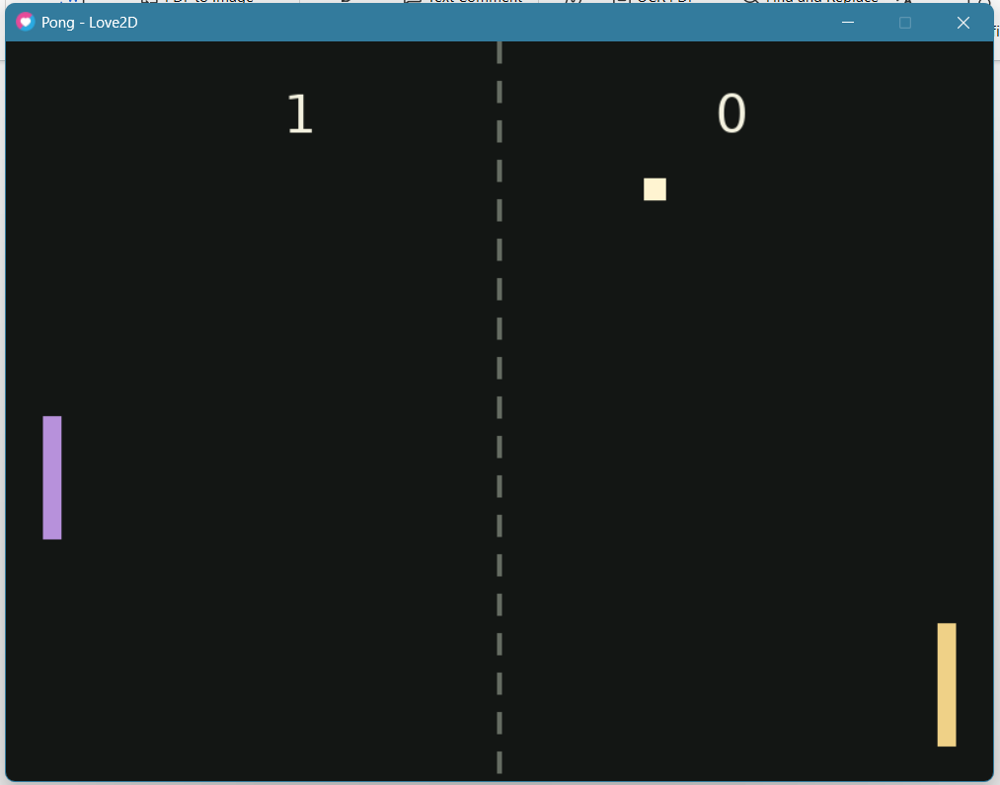

# Pong Game in Love2D

## Student Information

- **Full name:** Mohammad Hussain
- **Class:** Artificial Intelligence and Games
- **Department/section:** CAP (Software Engineering)

## Game Description

A two-player Pong game in which players use keyboard controls to return the ball across the screen. The ball bounces off the top and bottom walls and both paddles; when it passes a paddle, the opposing player earns a point. After each successful paddle hit, the ball speeds up slightly to make rallies more challenging, up to a maximum speed. The game uses a warm charcoal background with amethyst and champagne-gold paddles, an ivory ball, and one large score number for each player.

## Technologies

- Lua
- LÖVE (Love2D)
- Git/GitHub

## Installation and Running

1. Install LÖVE from [love2d.org](https://love2d.org/).
2. Open a terminal in the project root—the directory containing `main.lua`.
3. Run:

   ```text
   love .
   ```

## Controls

- **W:** Move the left paddle up.
- **S:** Move the left paddle down.
- **Up Arrow:** Move the right paddle up.
- **Down Arrow:** Move the right paddle down.

## How the Game Works

- `love.load()` sets the window and initializes paddles and the ball.
- `love.update(dt)` reads the controls, moves objects, and handles collisions. LÖVE calls it repeatedly while the game runs.
- `love.draw()` paints the background, center line, paddles, ball, and scores. Drawing only displays the current state; it does not change positions.
- `checkCollision(a, b)` uses Axis-Aligned Bounding Box (AABB) collision detection. It checks whether the horizontal and vertical ranges of two rectangles overlap.
- At the top and bottom walls, the ball's vertical velocity (`dy`) changes sign and its position is clamped to the screen edge.
- A paddle hit explicitly sends the ball toward the opponent: the left paddle sets `dx` positive (rightward), while the right paddle sets `dx` negative (leftward). The ball is placed just outside the paddle to prevent another response while resolving the overlap. The speed increase keeps the outgoing trajectory angle.
- When the ball passes a paddle, the other player scores and the ball returns to the center.

## Understanding Delta Time

**Delta time**, written `dt`, is the amount of time in seconds since the previous update. LÖVE passes it to `love.update(dt)`. It is a time interval, not a speed or a position.

Games run a loop many times each second. Each cycle reads input, updates the game state, and draws a frame. The number of cycles per second is the frame rate (FPS), and it can vary with the computer's workload.

If an object moves at `300` pixels per second, its movement for one update is `speed * dt`. At 60 FPS, one frame lasts about `1/60` second, so the object moves `300 * (1/60) = 5` pixels per frame. In one second it updates about 60 times: `60 * 5 = 300` pixels. At 30 FPS, a frame lasts about `1/30` second, so it moves `300 * (1/30) = 10` pixels per frame; over 30 frames that is `30 * 10 = 300` pixels. The per-frame steps differ, but the distance per second is the same (approximately, subject to frame timing).

**Position** says where an object is, in pixels. **Speed** is how much distance it covers per second, without a direction. **Velocity** includes direction: here `dx` and `dy` are the ball's horizontal and vertical velocity components in pixels per second. Positive `dx` moves right and negative `dx` moves left; positive `dy` moves down and negative `dy` moves up, because screen coordinates increase downward. The update adds `dx * dt` to `x` and `dy * dt` to `y`.

Movement belongs in `love.update(dt)` because that function advances the game state according to elapsed time. `love.draw()` may be called at a different rate; moving objects there would make motion depend on rendering frequency and could change positions more than once per update.

## My Original Feature

After every successful paddle return, ball speed increases by 20 pixels per second. The outgoing trajectory angle is kept, and total speed is capped at 520 pixels per second so rallies become more challenging without growing uncontrollably. The horizontal (`dx`) and vertical (`dy`) components are recalculated from that total speed, so the increase is real while the ball keeps its angle. A new serve starts at exactly 300 pixels per second.

## Project Structure

```text
PongGame/
├── main.lua             # Game setup, movement, collisions, and drawing
├── README.md            # Instructions and beginner-friendly explanations
├── .gitignore           # Temporary and editor-generated files to ignore
├── screenshots/image.png                 # Screenshot of the game running
└── demo/Recording 2026-10-29 153703.mp4  # Gameplay demo video
```

## Screenshot



## Demo Video

[Watch the Pong Game Demo](<demo/Recording 2026-10-29 153703.mp4>)

## GitHub Submission

Create a **public** GitHub repository named `pong-love2d`. After creating it, replace `YOUR-USERNAME` below with your GitHub username and run these commands from this project directory:

```bash
git remote add origin https://github.com/YOUR-USERNAME/pong-love2d.git
git push -u origin main
git status
```

The push is intentionally left for you to perform after creating the repository and confirming your account details.
